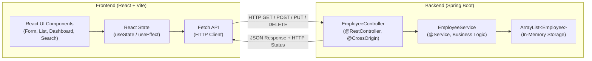

# 👥 Employee Management Portal

> A clean, production-ready, beginner-friendly Full-Stack Web Application built with **Java Spring Boot** (Backend) and **React.js + Vite** (Frontend), specifically structured for freshers preparing for Java Full-Stack Trainee technical interviews.

---

## 📌 1. Project Overview

The **Employee Management Portal** is a web-based administrative dashboard designed to streamline employee record management. It enables system administrators to perform full **CRUD** (Create, Read, Update, Delete) operations on employee data, complete with real-time field validation, duplicate detection, and live statistics.

To make the codebase simple, transparent, and easy to explain during interviews:
- The **Backend** uses **Java 17**, **Spring Boot**, and standard **RESTful APIs** with an in-memory `ArrayList<Employee>` (no external database configuration needed).
- The **Frontend** uses **React.js (Vite)**, standard **JavaScript (JSX)**, pure **CSS3** (no external UI libraries or CSS frameworks), and modern React Hooks (`useState`, `useEffect`).

---

## 🛠️ 2. Technology Stack

### Backend
- **Language**: Java 17 (or newer)
- **Framework**: Spring Boot 3.2.5
- **Modules**: Spring Web (`spring-boot-starter-web`), Spring Boot Test
- **Architecture**: MVC / Layered (Controller -> Service -> Model)
- **Data Structure**: `java.util.ArrayList<Employee>` (Thread-safe read patterns, in-memory)
- **Build Tool**: Apache Maven 3.9+
- **API Standard**: RESTful JSON over HTTP

### Frontend
- **Library**: React 18+
- **Build Tool**: Vite 5+
- **Language**: JavaScript (ES6+), JSX
- **Styling**: Pure CSS3 with Custom Properties (Variables) and Responsive Flexbox/Grid
- **State Management**: React Hooks (`useState`, `useEffect`)
- **HTTP Client**: Native Browser `Fetch API`

---

## ✨ 3. Key Features

1. **Dashboard Overview**:
   - Total employee headcount.
   - Distinct department count.
   - Average monthly payroll calculation.

2. **Add New Employee (Create)**:
   - Mandatory fields: Employee ID, Full Name, Email, Department, and Salary.
   - Unique Employee ID enforcement (prevents duplicate IDs).
   - Email format validation (`user@domain.ext`).
   - Positive salary validation (`salary > 0`).

3. **View All Employees (Read)**:
   - Modern tabular listing with initials avatar, department badge, and formatted currency.
   - Friendly empty-state illustration when no records exist.

4. **Search Employee by ID (Read)**:
   - Quick lookup by unique numeric ID.
   - Not-found feedback alert banner.
   - "Show All" one-click button to reset the view.

5. **Update Employee (Update)**:
   - Pre-fills form inputs with selected employee data.
   - Locks the primary ID field to prevent corruption.
   - Displays dynamic "Update Employee" and "Cancel" buttons.

6. **Delete Employee (Delete)**:
   - Removes employee from the system.
   - Browser confirmation popup (`window.confirm`) protects against accidental deletion.

---

## 🏛️ 4. System Architecture & Request Flow



### Request-Response Flow
1. **User Action**: The admin submits an employee form or clicks "Delete".
2. **Client Validation**: React performs client-side field checks (empty strings, email format, positive numbers).
3. **HTTP Dispatch**: React dispatches a JSON request via `fetch('http://localhost:8080/api/employees', { ... })`.
4. **Spring Routing**: `EmployeeController` intercepts the endpoint and delegates payload to `EmployeeService`.
5. **Business Logic & Persistence**: `EmployeeService` checks for ID collisions, validates business rules, and updates the `ArrayList<Employee>`.
6. **HTTP Response**: `EmployeeController` returns a `ResponseEntity` containing the updated record and standard status code (`200 OK`, `201 Created`, `400 Bad Request`, `404 Not Found`, or `409 Conflict`).
7. **UI Refresh**: React's `useState` triggers a re-render to instantly display updated data.

---

## 📁 5. Folder Structure

```
EmployeeManagementPortal/
│
├── backend/                                # Spring Boot Application
│   ├── pom.xml                             # Maven Dependencies & Plugins
│   └── src/
│       ├── main/
│       │   ├── java/com/employee/
│       │   │   ├── EmployeeApplication.java# Spring Boot Application Entry Point
│       │   │   ├── controller/
│       │   │   │   └── EmployeeController.java # REST Controller (CRUD Endpoints)
│       │   │   ├── exception/
│       │   │   │   ├── DuplicateResourceException.java
│       │   │   │   ├── ErrorResponse.java
│       │   │   │   ├── GlobalExceptionHandler.java # @RestControllerAdvice
│       │   │   │   ├── ResourceNotFoundException.java
│       │   │   │   └── ValidationException.java
│       │   │   ├── model/
│       │   │   │   └── Employee.java       # Encapsulated Entity Class
│       │   │   └── service/
│       │   │       └── EmployeeService.java# Business Logic & In-Memory ArrayList
│       │   └── resources/
│       │       └── application.properties  # Server Port (8080) & App Config
│       └── test/java/com/employee/
│           └── EmployeeServiceTest.java    # JUnit 5 Unit Tests (11 test cases)
│
├── frontend/                               # React + Vite Application
│   ├── package.json                        # Node Scripts & Dependencies
│   ├── vite.config.js                      # Vite Config (Port 5173)
│   ├── index.html                          # Root HTML5 Template
│   └── src/
│       ├── main.jsx                        # React Root Mount
│       ├── App.jsx                         # Main Container & CRUD State Coordination
│       ├── App.css                         # Custom Vanilla CSS Stylesheet
│       └── components/
│           ├── Navbar.jsx                  # Header Navigation Bar
│           ├── Dashboard.jsx               # Statistical Metrics Cards
│           ├── EmployeeForm.jsx            # Add / Edit Employee Form
│           ├── EmployeeList.jsx            # Tabular Employee Directory
│           └── SearchEmployee.jsx          # Search-by-ID Input & Filter
│
└── README.md                               # Comprehensive Documentation
```

---

## ⚙️ 6. Prerequisites

Ensure your system has the following installed:
1. **Java Development Kit (JDK)**: Version 17 or higher (`java -version`)
2. **Apache Maven**: Version 3.8+ (`mvn -version`)
3. **Node.js**: Version 18+ (`node -v`) and npm (`npm -v`)

---

## 🚀 7. Installation & Running Instructions

### Step 1: Start the Backend (Spring Boot)

Open a terminal and navigate to the `backend/` folder:

```bash
cd backend
```

Build the project and run the unit tests:
```bash
mvn clean test
```

Start the Spring Boot server:
```bash
mvn spring-boot:run
```

*The backend will boot up on: **`http://localhost:8080`***

---

### Step 2: Start the Frontend (React + Vite)

Open a **new, separate terminal** and navigate to the `frontend/` folder:

```bash
cd frontend
```

Install the dependencies:
```bash
npm install
```

Start the Vite development server:
```bash
npm run dev
```

*The frontend will launch at: **`http://localhost:5173`***

Open `http://localhost:5173` in your web browser to use the portal.

---

## 🌐 8. REST API Documentation

Base URL: `http://localhost:8080/api/employees`

| Method | Endpoint | Description | Request Body | Success Status | Error Status |
|---|---|---|---|---|---|
| **GET** | `/api/employees` | Get all employees | None | `200 OK` | `500 Internal Error` |
| **GET** | `/api/employees/{id}` | Get employee by ID | None | `200 OK` | `404 Not Found` |
| **POST** | `/api/employees` | Create a new employee | JSON (Employee object) | `201 Created` | `400 Bad Request`, `409 Conflict` |
| **PUT** | `/api/employees/{id}` | Update existing employee | JSON (Updated fields) | `200 OK` | `400 Bad Request`, `404 Not Found` |
| **DELETE** | `/api/employees/{id}` | Delete employee by ID | None | `200 OK` | `404 Not Found` |

### Sample JSON Request Body (POST / PUT)
```json
{
  "id": 105,
  "name": "Karan Mehra",
  "email": "karan.mehra@example.com",
  "department": "Engineering",
  "salary": 72000.0
}
```

### Sample JSON Error Response (409 Conflict)
```json
{
  "timestamp": "2026-11-11T11:20:00.000",
  "status": 409,
  "error": "Conflict",
  "message": "An employee with ID 105 already exists."
}
```

---

## 📸 9. Application Screenshots

### Instructions to Add Screenshots:
1. Create a folder named `screenshots/` in the project root.
2. Capture full-page screenshots of the application running:
   - `dashboard.png`: Full portal with statistics and employee table.
   - `add-employee.png`: Adding a new employee with form validation.
   - `search-result.png`: Searching an employee by ID.
   - `update-employee.png`: Populated form in edit mode.
3. Link them in this section:
```markdown


```

---

## 🎓 10. Technical Interview Preparation Guide

This project is specially structured to demonstrate foundational full-stack competency:
- **Clean Architecture**: Separation of concerns between Controller, Service, and Model layers.
- **Object-Oriented Programming**: Encapsulation with private fields and getters/setters.
- **Defensive Programming**: Validating both on the client and server side.
- **RESTful Best Practices**: Using correct HTTP verbs (`GET`, `POST`, `PUT`, `DELETE`) and proper HTTP status codes (`200`, `201`, `400`, `404`, `409`).
- **Modern React**: Functional components, declarative UI state, and side-effect management via hooks.
